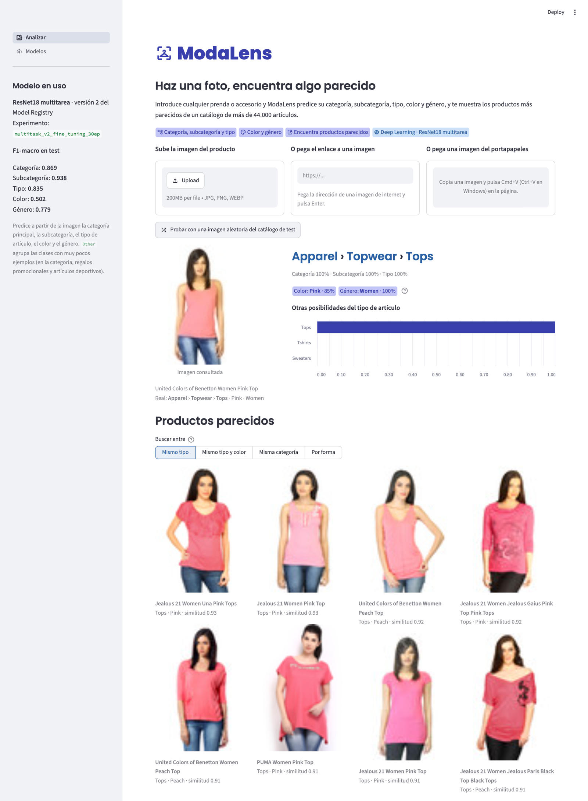
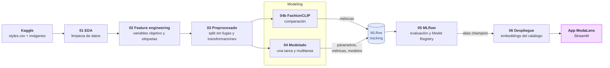
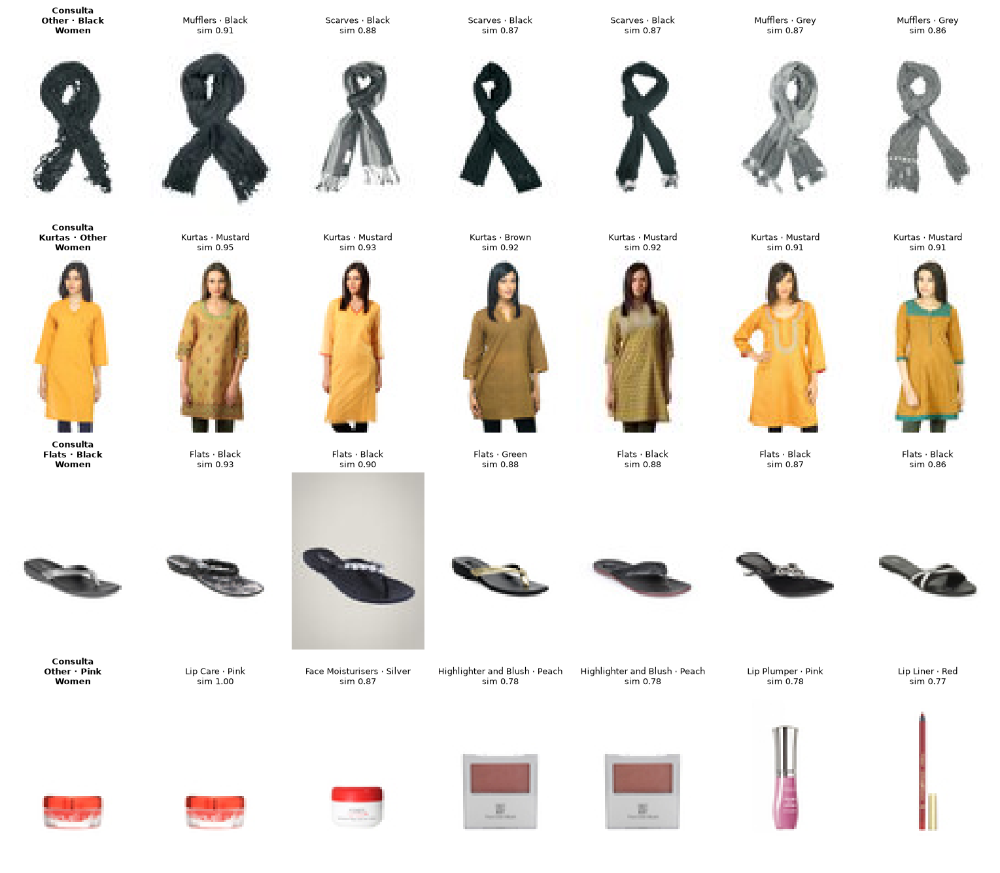

# ModaLens

**Trabajo Fin de Máster — Clasificación multitarea de productos de moda: de los datos a una aplicación con MLOps**

*La moda, vista por una red neuronal.* ModaLens analiza la imagen de un producto de moda, predice sus atributos y muestra los productos más parecidos de un catálogo de más de 44.000 artículos. Detrás hay un pipeline completo de MLOps: análisis y preparación de los datos, entrenamiento de redes convolucionales con *transfer learning*, registro de experimentos y versionado de modelos con MLflow, y despliegue en una app de Streamlit.



## Objetivo

Partiendo del dataset [Fashion Product Images (Small)](https://www.kaggle.com/datasets/paramaggarwal/fashion-product-images-small) (44.441 imágenes de 60×80 píxeles con sus metadatos), el proyecto recorre todo el ciclo de vida de un modelo de Deep Learning:

1. Explorar y limpiar los datos, y decidir qué se puede predecir a partir de la imagen.
2. Entrenar modelos que reconocen los atributos de un producto **solo a partir de su imagen**.
3. Registrar y comparar los experimentos con MLflow, y versionar los modelos en el Model Registry.
4. Desplegar el mejor modelo en una app que, además de describir el producto, recomienda productos visualmente parecidos.

## Pipeline



| Notebook | Qué hace |
|---|---|
| `01_eda` | Análisis exploratorio: valores nulos, calidad de las imágenes, duplicados, desbalance y jerarquía de categorías. |
| `02_feature_engineering` | Elige las variables objetivo, descarta como entrada la información no disponible en la app (marca, nombre), resuelve duplicados con etiquetas contradictorias y agrupa clases minoritarias. |
| `03_preprocessing` | Split train/val/test estratificado y agrupado por hash de imagen (sin duplicados entre conjuntos), pesos de clase y aumento de datos. |
| `04_modeling` | Experimentos con ResNet18: modelo de una tarea (extracción de características, fine-tuning y fine-tuning ponderado) y modelos multitarea (3 tareas, 5 tareas y el experimento de control sin color), todos registrados en MLflow. |
| `04b_fashionclip` | Compara el modelo multitarea con FashionCLIP congelado (*zero-shot* y *linear probe*) con las mismas clases y el mismo split. |
| `05_mlflow` | Compara los experimentos desde MLflow, evalúa los mejores en test y los registra en el Model Registry con el alias `champion`. |
| `06_deployment` | Calcula los embeddings del catálogo con los modelos `champion`, prueba la búsqueda de productos parecidos y analiza con Grad-CAM en qué zonas de la imagen se fija el modelo. |

## Evolución de los modelos

El problema se ha ido ampliando paso a paso, y cada paso queda registrado en MLflow:

1. **Modelo de una tarea**: una ResNet18 preentrenada en ImageNet que clasifica la categoría principal (`masterCategory`). Sirvió para comparar estrategias de *transfer learning* (extracción de características, fine-tuning y fine-tuning con pesos de clase) y fue la base de la primera versión de la app.
2. **Modelo multitarea**: una sola ResNet18 compartida con una salida por tarea, que predice a la vez la categoría, la subcategoría y el tipo de artículo.
3. **Multitarea v2**: añade el color y el género. Es el modelo que usa la app (alias `champion` en el Model Registry).
4. **Experimento de control (v3)**: el mismo modelo sin el color, para comprobar que la ligera pérdida del v2 en el tipo de artículo se debe al color (transferencia negativa entre tareas).
5. **Comparación con FashionCLIP**: un modelo de imagen y texto preentrenado con productos de moda, usado sin reentrenar (*zero-shot* y *linear probe*).

## Resultados

F1-macro en test (6.345 imágenes que no se usaron ni para entrenar ni para elegir el modelo):

| Modelo | Categoría | Subcategoría | Tipo | Color | Género |
|---|---|---|---|---|---|
| ResNet18, una tarea | 0,899 | — | — | — | — |
| ResNet18 multitarea (3 tareas) | 0,888 | 0,938 | 0,844 | — | — |
| **ResNet18 multitarea (5 tareas)** | **0,869** | **0,938** | **0,835** | **0,502** | **0,780** |
| ResNet18 multitarea (4 tareas, sin color) | 0,858 | 0,948 | 0,851 | — | 0,781 |
| FashionCLIP congelado + regresión logística | 0,830 | 0,938 | 0,862 | 0,531 | 0,792 |

Número de clases: 5 categorías, 23 subcategorías, 50 tipos, 28 colores y 5 géneros. Las clases con menos de 100 imágenes de entrenamiento se agrupan en `Other`.

Principales conclusiones:

- La métrica principal es el **F1-macro**, porque las clases están muy desbalanceadas: la accuracy de la categoría es del 99 % y ocultaría los errores en las clases pequeñas.
- En la categoría, las cuatro clases visuales se reconocen casi perfectamente (F1 ≥ 0,98). Las diferencias entre modelos vienen de `Other` (regalos promocionales y artículos deportivos, 19 imágenes en test), que no tiene un aspecto propio.
- Predecir varias tareas con una sola red apenas cuesta precisión y da mucho más detalle. El color es la tarea más difícil: los errores son sobre todo entre tonos parecidos (azul y azul marino, negro y gris). Además compite con las demás tareas: sin el color (4 tareas), el tipo de artículo mejora.
- Un modelo preentrenado específicamente en moda (FashionCLIP) iguala o mejora al modelo propio en varias tareas sin reentrenarlo, a cambio de ser unas 8 veces más grande.

**Búsqueda de productos parecidos:** la app usa la representación interna del modelo (un vector de 512 números por imagen) para encontrar los productos más cercanos del catálogo, dentro del mismo tipo, del mismo tipo y color, de la misma categoría o en todo el catálogo.



El análisis detallado de cada experimento está en los notebooks `04_modeling`, `04b_fashionclip` y `05_mlflow`.

## Cómo ejecutarlo

### Requisitos

- Python 3.12 y [uv](https://docs.astral.sh/uv/).
- Unos 700 MB de espacio para el dataset (y unos 600 MB más para descargar FashionCLIP, solo si se ejecuta `04b`).
- GPU recomendada para entrenar (el proyecto se desarrolló en un Apple M4 con PyTorch sobre MPS; también funciona con CUDA o CPU, más lento).

### Instalación

```bash
git clone https://github.com/larayc/tfm-mlops-fashion.git
cd tfm-mlops-fashion
uv sync
```

### Datos

Descarga el dataset de Kaggle y cópialo en `data/raw/` (puede pedir credenciales de Kaggle):

```bash
uv run python -c "import kagglehub, shutil; p = kagglehub.dataset_download('paramaggarwal/fashion-product-images-small'); shutil.copytree(p, 'data/raw', dirs_exist_ok=True)"
```

Deben quedar `data/raw/styles.csv` y `data/raw/images/`.

### Notebooks

Ejecuta los notebooks de `notebooks/` en orden (`01` → `06`) con el entorno del proyecto (`.venv`). Cada uno guarda sus resultados en `data/processed/` o en MLflow para el siguiente. El entrenamiento (`04_modeling`) tarda varias horas: cada modelo de 30 épocas con fine-tuning tarda unas 2 horas en el M4. `04b_fashionclip` es opcional (unos 20 minutos).

Para consultar los experimentos en la interfaz de MLflow:

```bash
uv run mlflow ui --backend-store-uri sqlite:///mlflow.db
```

y abre http://127.0.0.1:5000.

### App

Con los modelos registrados (`05_mlflow`) y los embeddings calculados (`06_deployment`), desde la raíz del proyecto:

```bash
uv run streamlit run app/streamlit_app.py
```

La app se abre en http://localhost:8501 y tiene dos páginas:

- **Analizar**: se da la imagen de un producto de cuatro formas (subirla, pegar su enlace, pegarla desde el portapapeles o probar con una imagen aleatoria de test). Muestra la ruta categoría › subcategoría › tipo con la confianza de cada nivel, el color y el género, las otras posibilidades del tipo de artículo y los productos más parecidos del catálogo.
- **Modelos**: métricas en test de los modelos registrados, comparación entre ellos, matrices de confusión e historial de versiones, leídos de MLflow.

La app usa siempre el modelo marcado como `champion` en el Model Registry, así que un modelo nuevo se puede poner en producción sin cambiar el código de la app.

## Estructura del proyecto

```
tfm-mlops-fashion/
├── app/                      # App ModaLens (Streamlit)
│   ├── streamlit_app.py      # Entrada: navegación, barra lateral y cabecera
│   ├── app_pages/            # Páginas "Analizar" y "Modelos"
│   ├── common.py             # Carga del modelo, catálogo y embeddings
│   ├── paste_image.py        # Componente para pegar imágenes del portapapeles
│   ├── brand_header.py       # Cabecera con el logo
│   └── assets/
├── notebooks/                # 01_eda → 06_deployment (y 04b_fashionclip)
├── src/fashion_mlops/        # Código reutilizable (paquete instalable)
│   ├── config.py             # Rutas, tamaño de imagen, configuración de MLflow
│   ├── data/                 # Etiquetas, split, Dataset de PyTorch y transformaciones
│   ├── features/             # Extracción de la marca
│   ├── models/               # Entrenamiento (una tarea y multitarea), MLflow,
│   │                         # predicción, embeddings y FashionCLIP
│   └── utils/                # Visualizaciones del EDA
├── reports/figures/          # Figuras del README
├── .streamlit/config.toml    # Tema de la app
├── pyproject.toml / uv.lock  # Dependencias
├── data/                     # Datos (no versionado)
├── mlflow.db, mlruns/        # Experimentos y modelos de MLflow (no versionado)
```

## Tecnologías

- **Datos:** pandas, NumPy, scikit-learn, Matplotlib, seaborn
- **Deep Learning:** PyTorch, torchvision (ResNet18 preentrenada), Hugging Face Transformers (FashionCLIP)
- **MLOps:** MLflow (tracking, Model Registry), uv
- **App:** Streamlit (con un componente propio para el portapapeles)

## Limitaciones y trabajo futuro

- `Other` no es una clase visual: sería mejor tratarla como "fuera de catálogo" o eliminarla del problema.
- Detectar imágenes que no son productos de moda (el modelo siempre elige una de sus clases).
- Grad-CAM indica que, para el género, el modelo se fija en parte en la persona que lleva la prenda (posible *shortcut learning*): evaluarlo con fotos de la prenda sola y recortar la prenda antes de clasificar.
- Predecir el color con un modelo o una rama separada, para que no penalice al tipo de artículo.
- Usar FashionCLIP como base de la app, o ajustarlo con el catálogo.
- Recomendar *looks*: combinar prendas compatibles a partir del tipo, el color y el género.
- Convertir el entrenamiento en un pipeline reproducible ejecutable desde la terminal, con versionado de datos (DVC) e integración continua.
